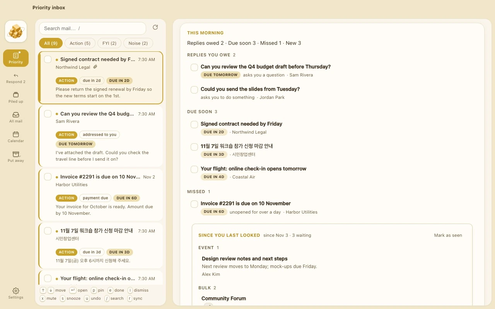
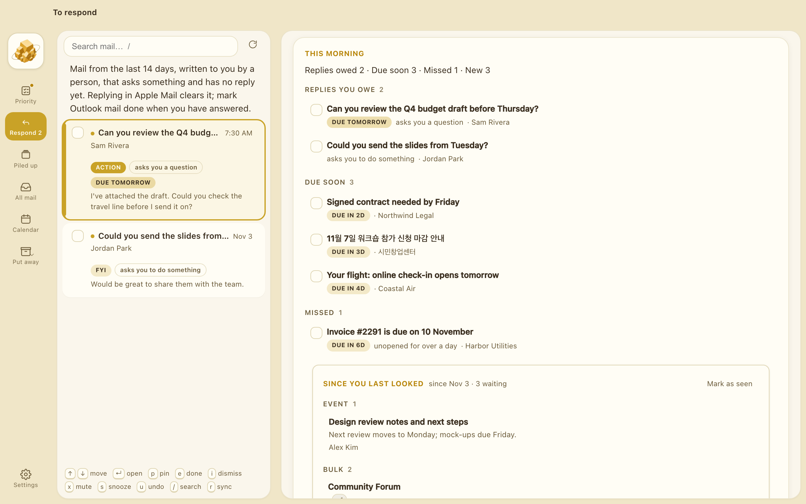
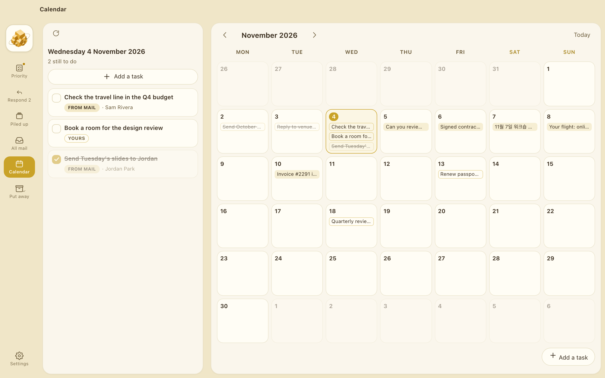
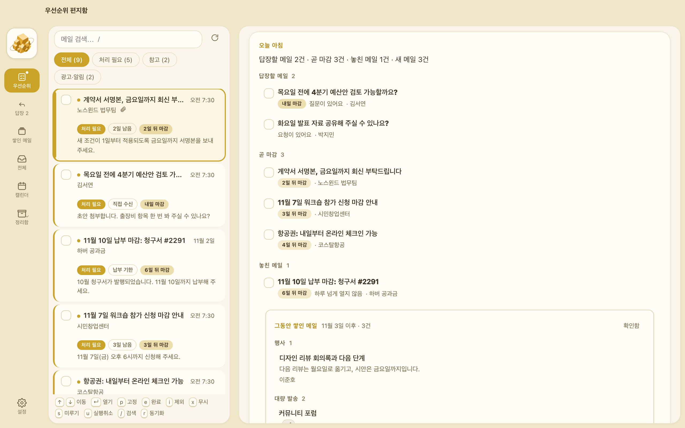
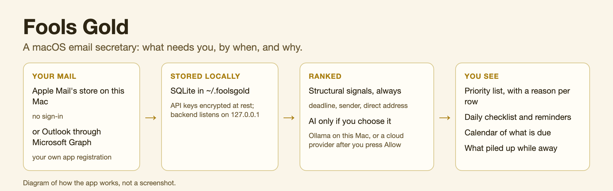

# Fools Gold

A macOS email secretary that ranks your inbox and pulls out deadlines, with AI optional.

[Quick start](#quick-start) · [How it works](#how-it-works) · [Privacy](docs/PRIVACY.md)

<picture>
  <source media="(prefers-color-scheme: dark)" srcset="docs/readme/hero-dark.webp">
  
</picture>

<sub>The real interface, run against a fake backend that serves demo mail instead of a mailbox, recorded in November 2026. [Still image](docs/readme/hero.png).</sub>

## Why use it

**It reads the mail already on your Mac.** The default source parses Apple Mail's local store, so there is no account to connect and no server of ours in between. A hosted filter such as [SaneBox](https://www.sanebox.com/help/155-how-does-sanebox-work) connects to your mail server instead. macOS asks you to grant Full Disk Access first.

**Ranking works with no AI and no key.** The default provider, `none`, ranks mail on deadlines, senders and direct address. A model is optional: Ollama on your Mac, whose model Settings can download for you, or Anthropic, OpenAI or GitHub Copilot on your own account. A cloud provider receives nothing until you have read who gets what and pressed Allow.

**It says why, and what you owe.** [Outlook's Focused Inbox](https://support.microsoft.com/en-us/outlook/mail/focused-inbox-for-outlook) splits mail into two tabs. Fools Gold orders one list, labels each row with its reason, such as a deadline or "addressed to you", lists the replies you owe, and puts due dates on a calendar with a checklist per day.

## Quick start

You need macOS, Python 3.11 or newer and Node.js 18 or newer. macOS ships Python 3.9, so install a newer one first with `brew install python@3.13`.

```bash
git clone https://github.com/A1bA-TroSs/FoolsGold-Agentic-Email-Secretary.git
cd FoolsGold-Agentic-Email-Secretary
./scripts/setup.sh    # builds the Python environment and the UI
npm start
```

`python3 scripts/check-mail.py` diagnoses mail store access without touching the app.

- [Set up Apple Mail](docs/APPLE_MAIL_SETUP.md): the default, including the Full Disk Access step
- [Set up Outlook](docs/ENTRA_SETUP.md): needs an app registration in your own Entra tenant, which many organisations restrict

## What it does

- Priority list and all-mail list
- A morning report: replies you owe, deadlines from two days ago to a week ahead, important mail still unopened after a day, then what piled up since you last looked
- To respond: mail written to you that asks something and that you have not answered
- Exam, payment, ticket and calendar-invite notices are never hidden as noise unless you muted the sender
- To-dos read from message bodies, when a model is connected; deadlines, including Korean dates, are also found without one
- Calendar with a checklist per day; ticked items stay visible, struck through
- Morning and evening checklist reminders
- Mute or highlight a sender, not just a message
- Ranking that learns from your actions, switched on from the start for new installs
- Reply and forward with a review step: the exact message is shown before it can be sent, or saved to Drafts if the server refuses
- Interface in English, Korean, Chinese and Japanese, with four colour themes

| To respond | Calendar and checklist | Korean interface |
|---|---|---|
|  |  |  |

## How it works

<picture>
  <source media="(prefers-color-scheme: dark)" srcset="docs/readme/diagram-dark.png">
  
</picture>

An Electron shell runs a Python backend on 127.0.0.1 and a React interface. Everything is kept in `~/.foolsgold/`:

```
~/.foolsgold/foolsgold.db     mail cache, rankings, tasks, settings
~/.foolsgold/secret.key       encrypts API keys and OAuth tokens (mode 0600)
```

The folder holds a copy of your mail and the key stored beside what it encrypts, so treat it like your mailbox. Delete it and the app is factory-fresh. There is no telemetry. See the [draft privacy policy](docs/PRIVACY.md) for what each provider receives.

## Status and limits

- Version 1.2.7, run from source. No packaged release is published yet.
- macOS only, and the packaging config targets Apple Silicon. The Apple Mail route reads only what Apple Mail has downloaded.
- The privacy policy is a draft with unfilled fields.
- Not for shared machines: the local database is protected only by your user account.
- Not in the Mac App Store, whose sandbox blocks reading `~/Library/Mail`.

## Contributing

Branch from `develop` and open pull requests against it, using Conventional Commits. Turn on the commit message check with:

```bash
git config core.hooksPath .githooks
```

```bash
cd backend && .venv/bin/python -m pytest   # backend tests
npm run test:electron                      # reminders and backend guard
cd frontend && npm run dev                 # UI with hot reload
```

## License

No license yet, all rights reserved.
